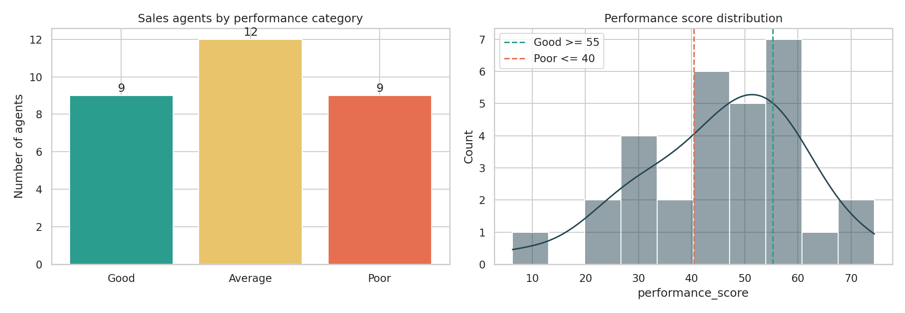
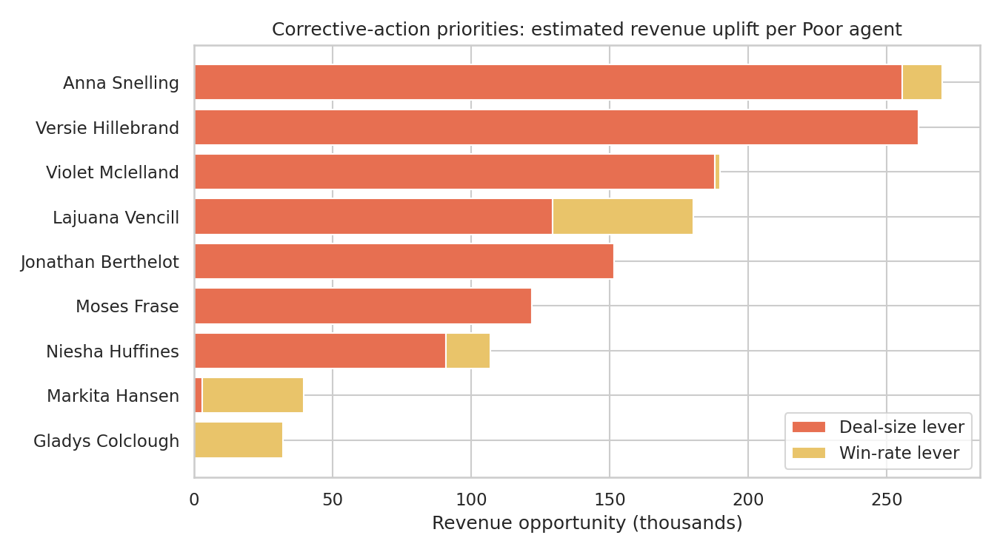

# Sales Agent Performance & Pipeline Analytics

Analysis of a B2B sales pipeline to find out which sales agents convert opportunities into revenue, which underperform, why, and where management action pays off most.

**Tech stack:** Python, Pandas, NumPy, Matplotlib, Seaborn, SQL (SQLite)

## Dataset
**CRM Sales Opportunities** (Maven Analytics, public domain): a fictitious computer-hardware company's B2B pipeline.

| File | Contents |
|---|---|
| `sales_pipeline.csv` | 8,800 opportunities: agent, product, account, deal stage, dates, close value |
| `sales_teams.csv` | 35 agents with manager and regional office |
| `accounts.csv` | 85 customer accounts with sector, size, location |
| `products.csv` | 7 products with series and list price |
| `data_dictionary.csv` | Field descriptions |

Source: https://mavenanalytics.io/data-playground/crm-sales-opportunities

## What this project does
- Cleans the data (product-name and typo fixes, structural nulls explained rather than imputed, integrity checks)
- Aggregates per agent with SQL (conditional aggregation and a join to the team table)
- Builds KPIs: **win rate**, **conversion rate**, **revenue per opportunity**, average deal size, sales cycle length
- Computes a **weighted performance score** and classifies agents as **Good / Average / Poor**
- Tests whether agent differences are real or random noise (z-scores on win rate)
- Visualises performance by agent, team, product, sector, funnel and month
- Checks how stable the classification is under alternative weightings
- Sizes the revenue opportunity from fixing Poor agents and diagnoses each one's main weakness

## Key results
- 30 active agents, 8,800 opportunities, about 10.0M won revenue; the team wins 63% of decided deals
- Win rates are similar across agents (55% to 70%); only 2 of 30 differ from average by more than chance
- Poor agents differ mainly in **deal size**: only 30% of their wins are premium products, against 56% for Good agents
- 7 of the 9 Poor agents sit in the Central region
- Raising Poor agents' deal size to the median is worth about 1.2M; raising their win rate is worth only about 0.15M




## Project structure
```
├── data/            # the five source CSVs
├── images/          # charts exported by the notebook
├── outputs/         # agent_scorecard.csv, poor_agent_action_list.csv
├── notebooks/
│   └── crm_sales_performance_analysis.ipynb
├── requirements.txt
└── README.md
```

## How to run
```bash
git clone https://github.com/<your-username>/crm-sales-performance-analytics.git
cd crm-sales-performance-analytics
pip install -r requirements.txt
jupyter notebook notebooks/crm_sales_performance_analysis.ipynb
```

## Limitations
The data covers one year for a fictitious company with 30 agents. Score weights are judgment-based, and Good/Poor cut-offs are percentile-based, so a bottom group always exists. See the notebook's final section for details.
